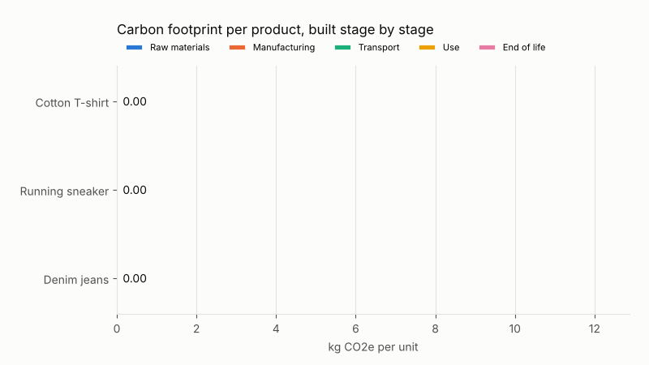
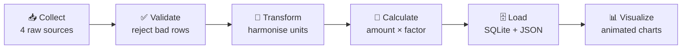
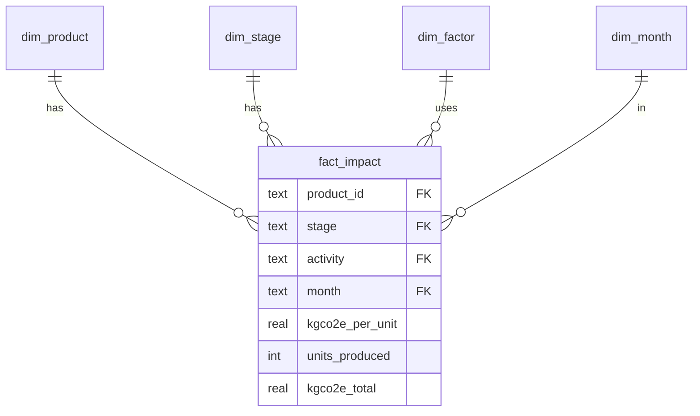
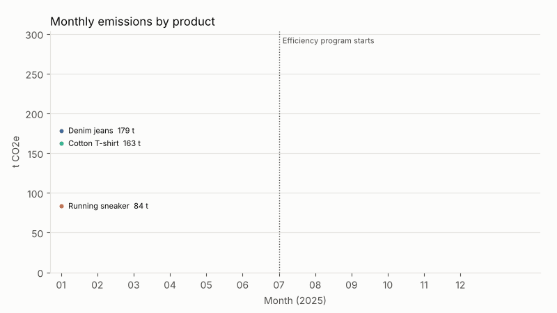
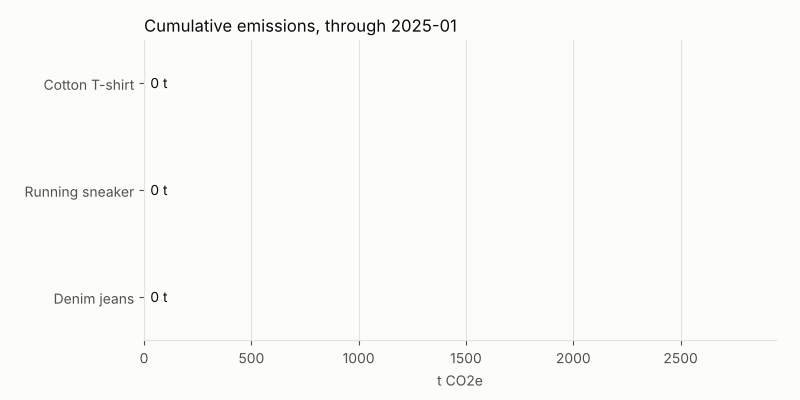
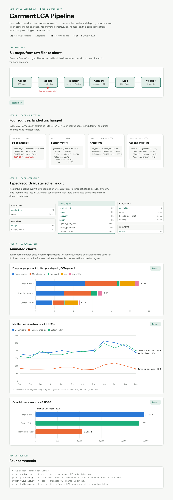

<div align="center">

# 🌱 Garment LCA Pipeline

**An end-to-end Life Cycle Assessment data pipeline: from raw supplier data to animated carbon footprint charts.**




</div>

---

## 📖 About

This project calculates the **carbon footprint** of three clothing products across their **whole life cycle**:

| 👕 Cotton T-shirt | 👖 Denim jeans | 👟 Running sneaker |
|:---:|:---:|:---:|

```
Raw materials  ➜  Manufacturing  ➜  Transport  ➜  Use  ➜  End of life
```

It is an example of an **end-to-end data pipeline for Life Cycle Assessment (LCA)**, using simulated data for 2025.

---

## 🔄 How the pipeline works



### 1️⃣ Data collection

The project gathers data from four sources, each in its own format, and saves the files **unchanged** in `data/raw/`:

| Source | Format | What it contains |
|---|:---:|---|
| 🧵 Bill of materials | `CSV` | The materials in each product and their quantities |
| ⚡ Factory meters | `JSON` | Monthly electricity and gas use, and units produced |
| 🚢 Shipments | `CSV` | Sea, truck and air freight distances |
| ♻️ Use & end of life | `JSON` | Washing and disposal assumptions |

### 2️⃣ Data structure

- Each piece of data becomes a **typed Python record** (`dataclass`) that checks itself for errors.
- Results are loaded into a **SQLite star schema**: one central fact table linked to small lookup tables.



### 3️⃣ Data pipeline

`extract → validate → transform → calculate → load`

| Step | What happens |
|---|---|
| ✅ **Validate** | Finds and rejects bad records, such as a material with no quantity |
| 🔧 **Transform** | Converts units (g → kg, MWh → kWh) and works out tonne-kilometres for shipping |
| 🧮 **Calculate** | `impact = amount × emission factor` |
| 🗄️ **Load** | Writes results to the database and to a JSON summary for the charts |

### 4️⃣ Animated charts

<table>
  <tr>
    <td align="center"><b>Monthly emissions</b><br/></td>
    <td align="center"><b>Cumulative bar race</b><br/></td>
  </tr>
</table>

- **matplotlib GIFs:** stacked bars that build up one stage at a time, monthly lines that draw themselves in, and a cumulative "bar race" where bars re-sort as they grow.
- **Interactive web page** (`output/lca_dashboard.html`): an animated diagram of data moving through the pipeline, plus the same charts with hover values and Replay buttons. Works in light and dark mode.

<details>
<summary>🖼️ <b>Preview the interactive page</b></summary>
<br/>

</details>

---

## 📊 Key results

> Simulated data, 2025

| Product | kg CO2e per unit | Largest source |
|---|---:|---|
| 👖 Denim jeans | **10.91** | Raw materials (48%) |
| 👟 Running sneaker | **7.07** | Raw materials (43%) |
| 👕 Cotton T-shirt | **4.68** | Raw materials (38%) |

- 🌍 Total across all three products: **≈ 5,866 t CO2e** for the year.
- ⚡ A factory efficiency program starting in July cut electricity use per unit by **about 12%**.

---

## 🚀 Quick start

```bash
git clone https://github.com/malleshkomal/simple-t-shirt-example.git
cd simple-t-shirt-example
pip install -r requirements.txt

python collect.py      # 1. collect raw data      -> data/raw/
python pipeline.py     # 2-3. structure + pipeline -> data/processed/
python visualize.py    # 4. animated GIF charts    -> output/*.gif
python build_page.py   # 4. interactive web page   -> output/lca_dashboard.html
```

---

## 📁 Project structure

```
simple-t-shirt-example/
├── collect.py             # Step 1 · data collection
├── schema.py              # Step 2 · dataclasses + star schema
├── pipeline.py            # Step 3 · extract → validate → transform → calculate → load
├── visualize.py           # Step 4 · animated matplotlib GIFs
├── build_page.py          # Step 4 · builds the interactive HTML page
├── page_template.html
├── requirements.txt
├── data/
│   ├── raw/               # source files, stored unchanged
│   └── processed/         # lca.db + lca_summary.json
├── output/                # GIFs + lca_dashboard.html
└── docs/                  # README images
```

---

## 🛠️ Tech stack

| Layer | Tools |
|---|---|
| Language | Python |
| Data processing | pandas |
| Storage | SQLite (star schema) |
| Animation | matplotlib (`FuncAnimation`) |
| Interactive page | HTML · SVG · JavaScript |

---

> [!NOTE]
> The data and emission factors are **example values for learning**. To use this for real, replace the functions in `collect.py` with connectors to your data sources, and load emission factors from a recognised database such as **ecoinvent**, **DEFRA** or the **EPA**.

<div align="center">

⭐ If you found this useful, consider giving the repo a star!

</div>
